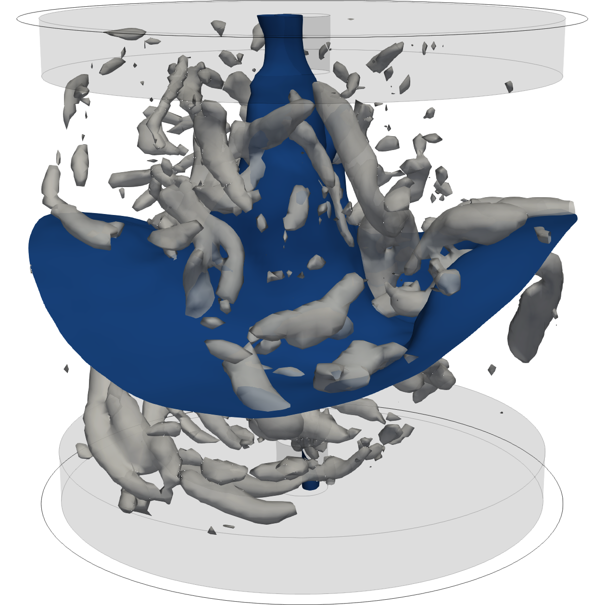
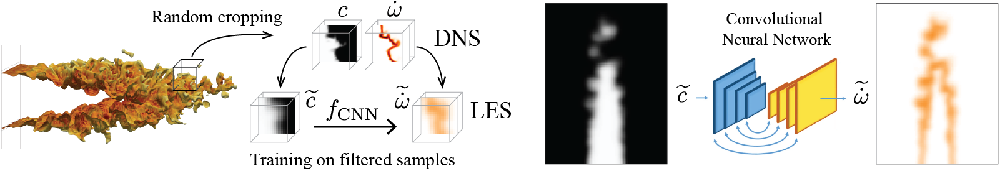
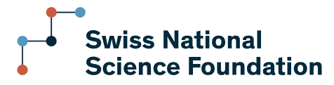

# Data-driven modelling for large eddy simulation

## Impeller-driven turbulent flows

The turbulent swirling flow in a von Kármán device exhibits metastability, with slow switching between large-scale flow states. Studying these dynamics requires long simulations at high Reynolds numbers, for which resolving the impeller blades is computationally prohibitive. This work uses experimental particle image velocimetry (PIV) and torque measurements to model how the impellers drive the flow. A B-spline parametrisation of velocity within the impeller region supplies momentum forcing to the large eddy simulation (LES). Initial coefficients are inferred with the Optimizing a DIscrete Loss (ODIL) framework, combining constraints from the Reynolds-averaged Navier–Stokes (RANS) equations with PIV data in optically accessible regions and measured impeller torques. The Covariance Matrix Adaptation Evolution Strategy (CMA-ES) then refines these coefficients to improve agreement between experimental measurements and LES predictions of mean velocity and torque.

The model enables long-duration LES that recover the mean flow and torque, and exhibit switching between metastable states. Crucially, these states and their transitions emerge intrinsically from the flow dynamics of the device, without any imposed time-dependent forcing. Neither the metastable states nor their transition statistics are included in the optimisation objective. These states have a non-axisymmetric pattern of four alternating cells, rotating slowly about the vessel axis. Beyond this particular configuration, the proposed modelling strategy offers a promising approach to investigating slow, large-scale dynamics in other impeller-driven turbulent flows.

More details in this [journal publication](https://doi.org/10.1103/nbpv-s32c), also available on [arXiv](https://doi.org/10.48550/arXiv.2607.25048).

 
<em>Figure VK: Flow structures in a large eddy simulation of the impeller-driven von Kármán flow. More details in this <a href="https://doi.org/10.1103/nbpv-s32c">journal publication</a>.</em>

## Hydrogen combustion

Large eddy simulation (LES) plays a key role in the design of new combustion chambers for robust and safe combustion of carbon-free fuels such as H2. It is a very efficient method which consists of filtering and modelling small-scale flow physics that would otherwise be very computationally expensive to resolve. However, the high molecular diffusion of H2 challenges subfilter-scale modelling for lean premixed mixtures. This work establishes a framework for data-driven machine learning modelling of LES burning rates, enabling high-fidelity simulation of hydrogen combustion systems that are essential for achieving a low-carbon economy.

The data-driven approach leverages a convolutional neural network (CNN), trained to approximate filtered burning rates from emulated LES data. From emulated LES fields, a CNN has been trained to estimate the LES burning rates based on known LES scalars. Once trained, the model was found to approximate the burning rates on solutions never seen during training with high accuracy. In addition, the model was able to approximate burning rates on filter sizes and equivalence ratios other than those used for training.

More details in this [journal publication](https://doi.org/10.1017/dce.2025.1). The training database is available on Kaggle via [BLASTNet](https://www.kaggle.com/organizations/blastnet).

 
<em>Figure CNN-H2: Diagram of the strategy used to generate data and train the CNN. More details in this <a href="https://doi.org/10.1017/dce.2025.1">journal publication</a>.</em>

  

    
  

  

    This research was funded in part by the Swiss National Science Foundation (SNSF) under grant agreement No. 219938.
  

  

    
  

  

    This work was supported by a grant from the Swiss National Supercomputing Centre (CSCS) under project ID s1262.
  

