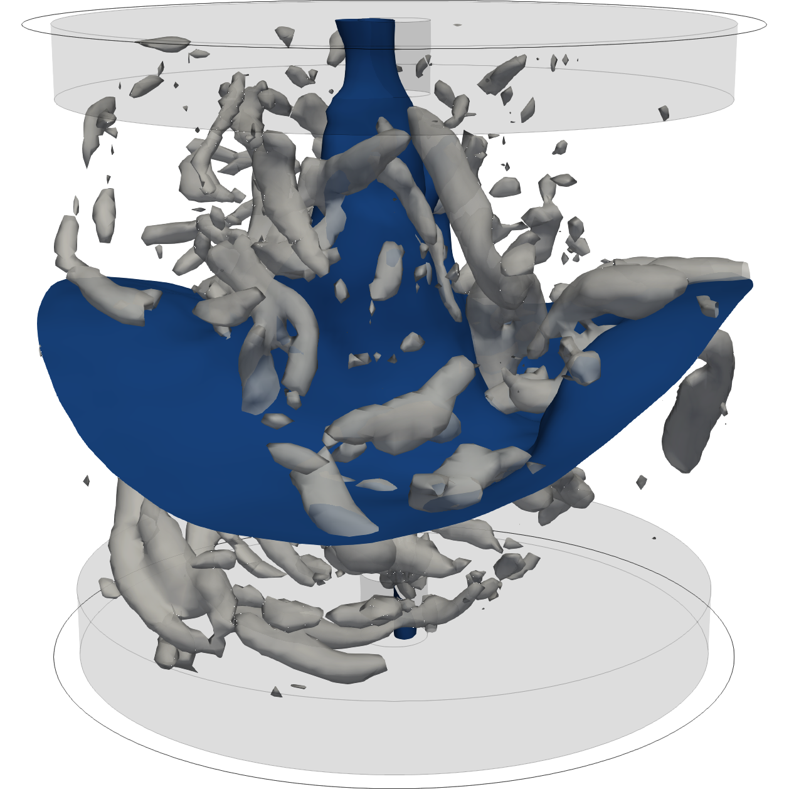

# Impeller-driven turbulent flows

The turbulent swirling flow in a von Kármán device exhibits metastability, with slow switching between large-scale flow states. Studying these dynamics requires long simulations at high Reynolds numbers, for which resolving the impeller blades is computationally prohibitive. This work uses experimental particle image velocimetry (PIV) and torque measurements to model how the impellers drive the flow. A B-spline parametrisation of velocity within the impeller region supplies momentum forcing to the large eddy simulation (LES). Initial coefficients are inferred with the Optimizing a DIscrete Loss (ODIL) framework, combining constraints from the Reynolds-averaged Navier–Stokes (RANS) equations with PIV data in optically accessible regions and measured impeller torques. The Covariance Matrix Adaptation Evolution Strategy (CMA-ES) then refines these coefficients to improve agreement between experimental measurements and LES predictions of mean velocity and torque.

The model enables long-duration LES that recover the mean flow and torque, and exhibit switching between metastable states. Crucially, these states and their transitions emerge intrinsically from the flow dynamics of the device, without any imposed time-dependent forcing. Neither the metastable states nor their transition statistics are included in the optimisation objective. These states have a non-axisymmetric pattern of four alternating cells, rotating slowly about the vessel axis. Beyond this particular configuration, the proposed modelling strategy offers a promising approach to investigating slow, large-scale dynamics in other impeller-driven turbulent flows.

More details in this [journal publication](https://doi.org/10.1103/nbpv-s32c), also available on [arXiv](https://doi.org/10.48550/arXiv.2607.25048).

 
<em>Figure VK: Flow structures in a large eddy simulation of the impeller-driven von Kármán flow. More details in this <a href="https://doi.org/10.1103/nbpv-s32c">journal publication</a>.</em>

