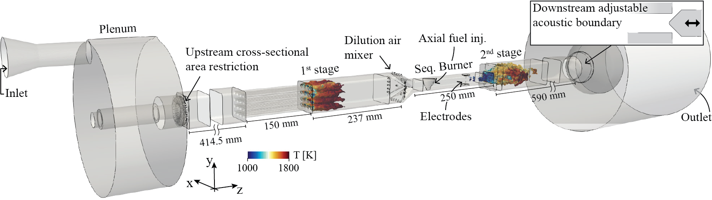
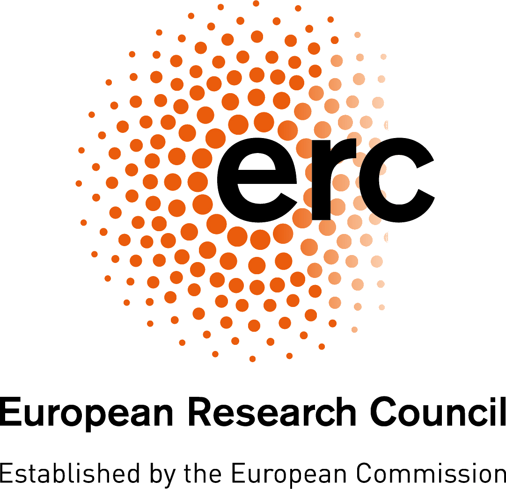

# Thermoacoustic stabilisation

Plasma-assisted combustion using nanosecond repetitively pulsed discharges (NRPDs) is an emerging technology that enhances the reactivity of fuel-air mixtures, offering significant improvements in operational and fuel flexibility — two crucial features for future sustainable gas turbines. The mechanisms of stabilisation have been studied using massively parallel large eddy simulation (LES) combined with an accurate description of the combustion chemistry and a state-of-the-art phenomenological model for the non-equilibrium plasma effects. The simulation framework has been validated by comparison with experimental data including acoustic pressure and heat release rate (HRR) signals in both stages of the sequential combustor, and OH-planar laser-induced fluorescence images in the second stage combustion chamber.

The animation below illustrates the simulation results with a stabilisation of the thermoacoustically unstable sequential combustor by the non-thermal plasma. Figure LES-PAC-FULLSEQCOMB shows the sequential combustor setup used for both experiments and simulation. More details in this [journal publication](https://doi.org/10.1016/j.proci.2024.105277).

<video style="width: 700px; max-width: 100%; height: auto;" controls autoplay muted loop>
  <source src="/assets/images/gallery/SM_PROCI_FULLSEQCOMB.mp4" type="video/mp4">
</video> 
<em>Animation of line-of-sight averaged heat release rate (HRR) along the x-axis from LES snapshots. The pressure in the first and second stages is plotted live at the top of the animation. A thermoacoustic instability with strong fluctuations in pressure and HRR can be observed, followed by stabilisation when plasma discharges are activated in the sequential burner. More details in this <a href="https://doi.org/10.1016/j.proci.2024.105277">journal publication</a>.</em>

 
<em>Figure LES-PAC-FULLSEQCOMB: Diagram of the sequential combustor used for the experiments and numerical simulations. The temperature-coloured iso-surfaces of HRR depict the two flames. More details in this <a href="https://doi.org/10.1016/j.proci.2024.105277">journal publication</a>.</em>

  

    
  

  

    This project has received funding from the European Research Council (ERC) under the European Union's Horizon 2020 research and innovation programme (grant agreement No. 820091 and grant agreement No. 952181).
  

  

    
  

  

    This work was supported by a grant from the Swiss National Supercomputing Centre (CSCS) under project ID s1220.
  

